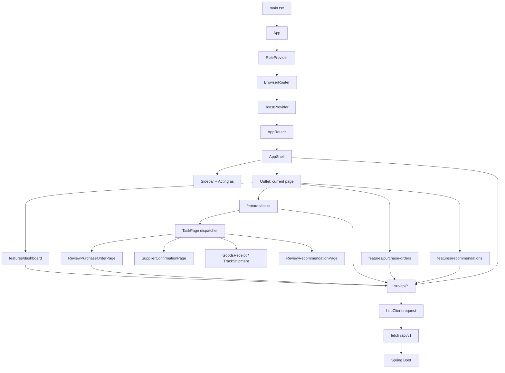
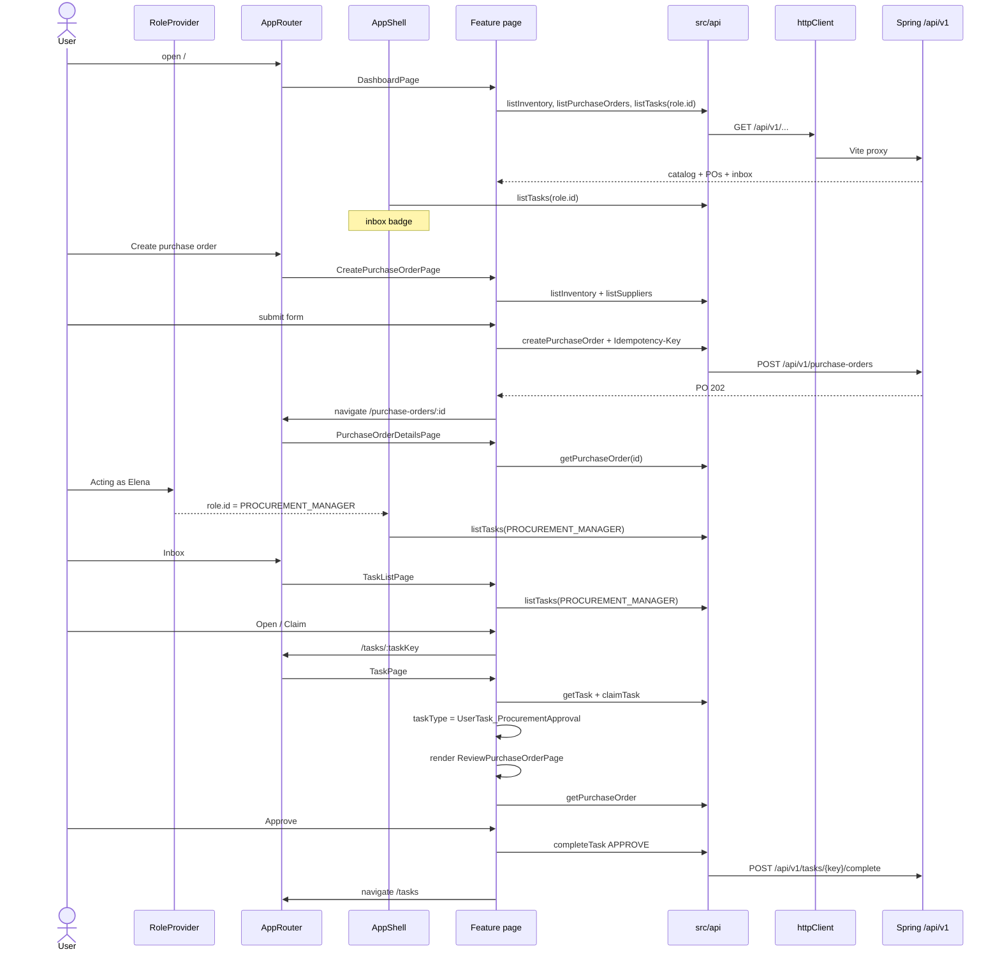

# Frontend control flow

How React **app**, **features**, **components**, and **APIs** are wired, and how control passes from one to another.

The browser never talks to Camunda. Feature screens call `src/api/*`, which call `httpClient`, which `fetch`es `/api/v1`. Vite proxies that to Spring Boot.

---

## Scenario

**Marcus (procurement buyer) creates a purchase order. After Camunda opens an approval task, Elena (procurement manager) claims it in Inbox and approves it.**

Control always moves the same way:

**route → feature page → `useLoad` or a submit handler → `src/api/*` → `httpClient` → `/api/v1` (Vite proxy) → Spring**

Shared chrome (`AppShell`, demo role, toast) stays mounted while the page in `Outlet` changes.

---

## How the React tree is wired

`AppShell` never unmounts. Only the feature page inside `Outlet` swaps. `TaskPage` does not render a form itself: it loads the task from the backend, then picks a feature screen from `task.taskType`.

---

## Control flow for the scenario

After Approve, Spring completes the Camunda user task. The next human step (finance, supply chain, supplier, warehouse) appears later in Inbox for that candidate group. The UI only reacts to whatever `GET /api/v1/tasks/{taskKey}` returns.

---

## Routes

| URL | Feature page |
|---|---|
| `/` | `DashboardPage` |
| `/tasks` | `TaskListPage` |
| `/tasks/:taskKey` | `TaskPage` (dispatcher) |
| `/purchase-orders` | `PurchaseOrderListPage` |
| `/purchase-orders/new` | `CreatePurchaseOrderPage` |
| `/purchase-orders/:id` | `PurchaseOrderDetailsPage` |
| `/recommendations` | `RecommendationsListPage` |
| `/recommendations/:id` | `RecommendationDetailPage` |

### TaskPage dispatcher

| `task.taskType` | Renders |
|---|---|
| `UserTask_ReviewRecommendation` | `ReviewRecommendationPage` |
| `UserTask_ProcurementApproval` | `ReviewPurchaseOrderPage` |
| `UserTask_FinanceApproval` | `ReviewPurchaseOrderPage` |
| `UserTask_SupplyChainApproval` | `ReviewPurchaseOrderPage` |
| `UserTask_RevisePO` | `RevisePurchaseOrderPage` |
| `UserTask_SupplierConfirmation` | `SupplierConfirmationPage` |
| `UserTask_TrackShipment` | `TrackShipmentPage` |
| `UserTask_GoodsReceipt` | `GoodsReceiptPage` |

---

## Folder roles

| Layer | Folder / file | Job |
|---|---|---|
| Boot | `src/main.tsx`, `src/app/App.tsx` | Mount React, wrap providers |
| Routing | `src/app/router.tsx` | URL → feature page |
| Chrome | `src/components/AppShell.tsx` | Nav, role switcher, inbox count |
| Features | `src/features/*` | Screens and submit handlers |
| Shared UI | `src/components/*` | `PageHeader`, badges, form fields |
| API | `src/api/*` | One module per backend resource |
| HTTP | `src/api/httpClient.ts` | `fetch`, JSON, 8s timeout, errors |
| Shared state | `RoleContext`, `ToastContext`, `useLoad` | Demo role, success toast, load/error |

The sidebar **Acting as** control is demo-only. It sets `candidateGroup` on `GET /api/v1/tasks`. It is not sent to Camunda from the browser.
